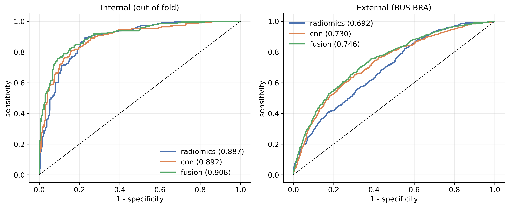
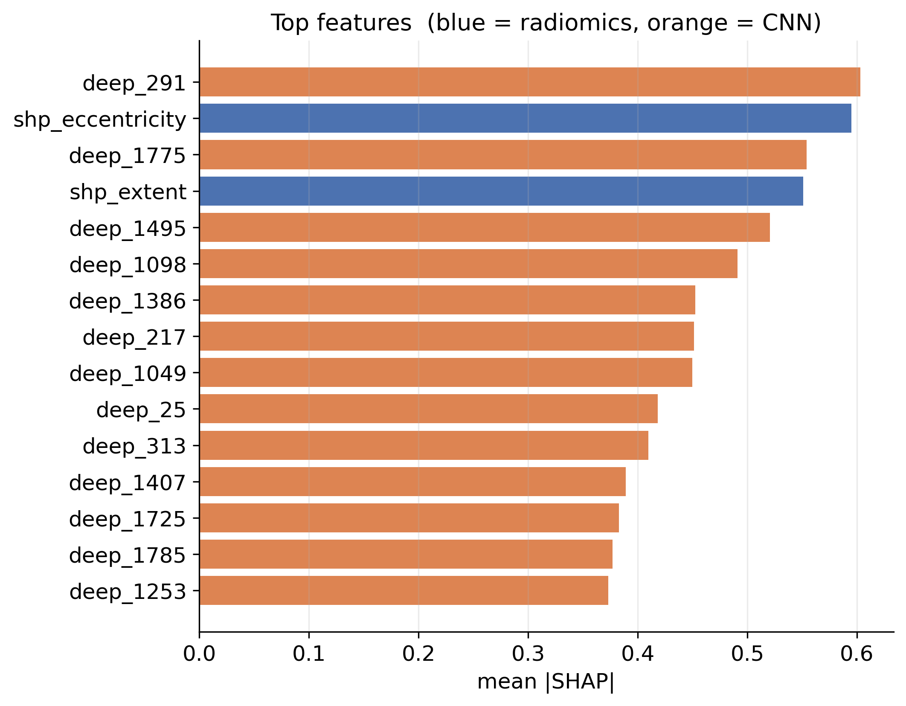

# Breast Ultrasound Lesion Classification with Segmentation-Guided Radiomics/CNN Fusion

Fully automatic benign vs. malignant classification of breast ultrasound lesions. A UNet++
segments the lesion, and handcrafted radiomics plus ResNet-50 deep features are extracted
from the predicted ROI and fused in a sparse logistic model. The model is trained on
**BUSI** and externally validated on **BUS-BRA**, a cohort from different scanners and a
different institution.

Code accompanying a manuscript currently under review.


## Pipeline

```
BUSI ── pHash dedup ──┬─► UNet++ (EfficientNet-B3) segmentation
                      └─► predicted-mask ROI ─┬─► radiomics (18) ──────┐
                                              └─► ResNet-50 (2048) ────┴─► Scaler → LASSO → LR
BUS-BRA ─────────────────────────────────────────────────────────────────► external test
```

- **Leakage control.** BUSI contains near-duplicate frames. Perceptual-hash dedup
  (Hamming ≤ 4) removes 152 of 780 images *before* any split, leaving 340 benign,
  193 malignant and 95 normal images.
- **No manual masks at inference.** Every classification ROI, internal and external,
  comes from the predicted segmentation. A reference-mask run is kept as an
  upper-bound ablation.
- **Nested selection.** Scaling, LASSO feature selection (inner CV) and the classifier are
  all fit inside each outer fold.
- **Statistics.** Stratified 5-fold CV (mean ± SD), DeLong tests on pooled out-of-fold
  predictions, and bootstrap 95% CIs (1000 resamples).
- **Explainability.** Exact linear SHAP on the fusion and radiomics-only models. Each
  deep feature is also profiled by the radiomics features it correlates with most.

## Results

**Segmentation** (BUSI held-out test, n = 107): median Dice 0.88.

**Classification, internal** (BUSI, 533 lesions, 5-fold CV):

| Model | AUC | Sensitivity | Specificity | Accuracy |
|---|---|---|---|---|
| Radiomics | 0.889 ± 0.020 | 0.860 ± 0.038 | 0.794 ± 0.045 | 0.818 ± 0.019 |
| CNN | 0.891 ± 0.018 | 0.761 ± 0.052 | 0.868 ± 0.034 | 0.829 ± 0.016 |
| **Fusion** | **0.908 ± 0.017** | 0.777 ± 0.047 | 0.879 ± 0.041 | 0.842 ± 0.028 |

**Classification, external** (BUS-BRA, 1875 images, 607 malignant):

| Model | AUC (95% CI) | Sensitivity | Specificity | Accuracy |
|---|---|---|---|---|
| Radiomics | 0.692 (0.667–0.715) | 0.435 | 0.789 | 0.674 |
| CNN | 0.730 (0.705–0.756) | 0.695 | 0.628 | 0.650 |
| **Fusion** | **0.746 (0.723–0.769)** | 0.666 | 0.690 | 0.682 |

On BUS-BRA, fusion beats radiomics (DeLong p < 0.001) and CNN (p = 0.005). Internally,
fusion beats CNN (p = 0.027), but its lead over radiomics is not significant (p = 0.12).
The internal-to-external drop of about 0.16 AUC shows the domain shift between the two
datasets.

| | |
|---|---|
|  |  |
|  |  |

All metric tables are in [`results/`](results/).

## Setup

```bash
git clone https://github.com/Darshan0109/breast-us-fusion.git
cd breast-us-fusion
pip install -r requirements.txt
```

The reported results used the scikit-image radiomics backend (18 first-order, GLCM and
shape features). Installing `pyradiomics` makes the notebook switch to the full
IBSI feature set automatically.

## Data

Neither dataset is redistributed here. Download them and place them under `data/`, or
point `DATA_DIR` somewhere else:

```
data/
├── Dataset_BUSI_with_GT/{benign,malignant,normal}/*.png
└── BUS_BRA/
    ├── bus_data.csv
    ├── Images/bus_XXXX-{l,r,s}.png
    └── Masks/mask_XXXX-{l,r,s}.png
```

- **BUSI**: Al-Dhabyani et al., *Data in Brief* 2020.
  [Kaggle](https://www.kaggle.com/datasets/aryashah2k/breast-ultrasound-images-dataset)
- **BUS-BRA**: Gómez-Flores et al., *Medical Physics* 2024.
  [Zenodo](https://zenodo.org/records/8231412)

## Usage

```bash
DATA_DIR=/path/to/data jupyter lab notebooks/breast_us_fusion_pipeline.ipynb
```

Run all cells. Everything is controlled by the `CONFIG` dict in the first code cell. The
U-Net checkpoint and feature tables are cached in `results/`, so later runs skip training
and extraction. Set `force_retrain_seg` or `force_rebuild_features` to `True` to redo
them. A full run (40 epochs plus feature extraction) takes well under an hour on a single
A100.

## Limitations

- BUSI has no patient IDs. Dedup reduces leakage, but splits are image-level.
- The segmenter and the internal classifiers share BUSI images, so internal
  predicted-mask results may be mildly optimistic. BUS-BRA is the clean
  generalisation estimate.

## License

MIT for the code. The datasets keep their original licenses.
