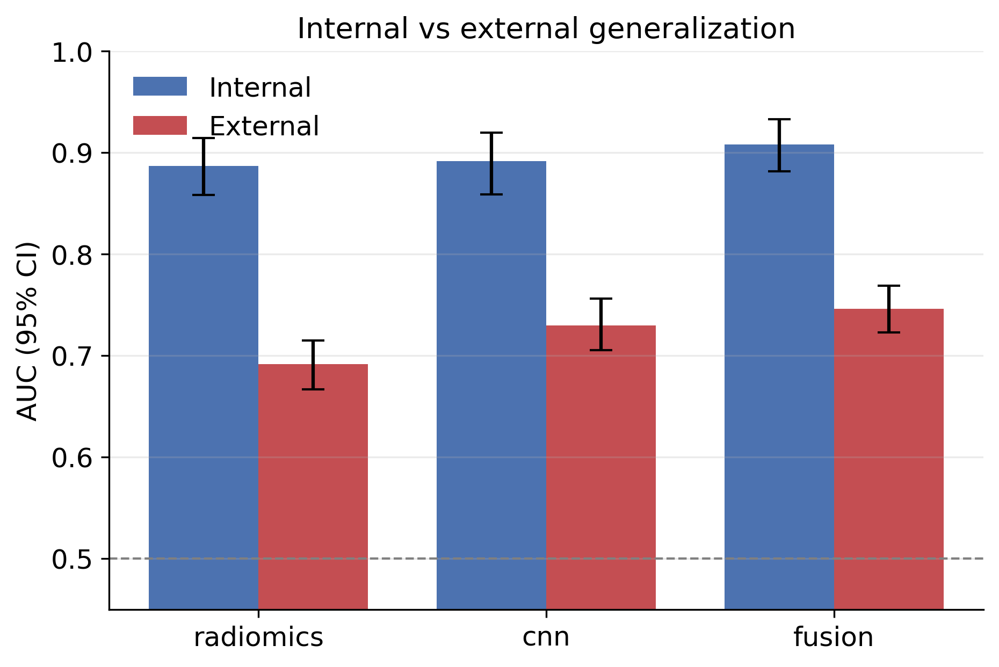
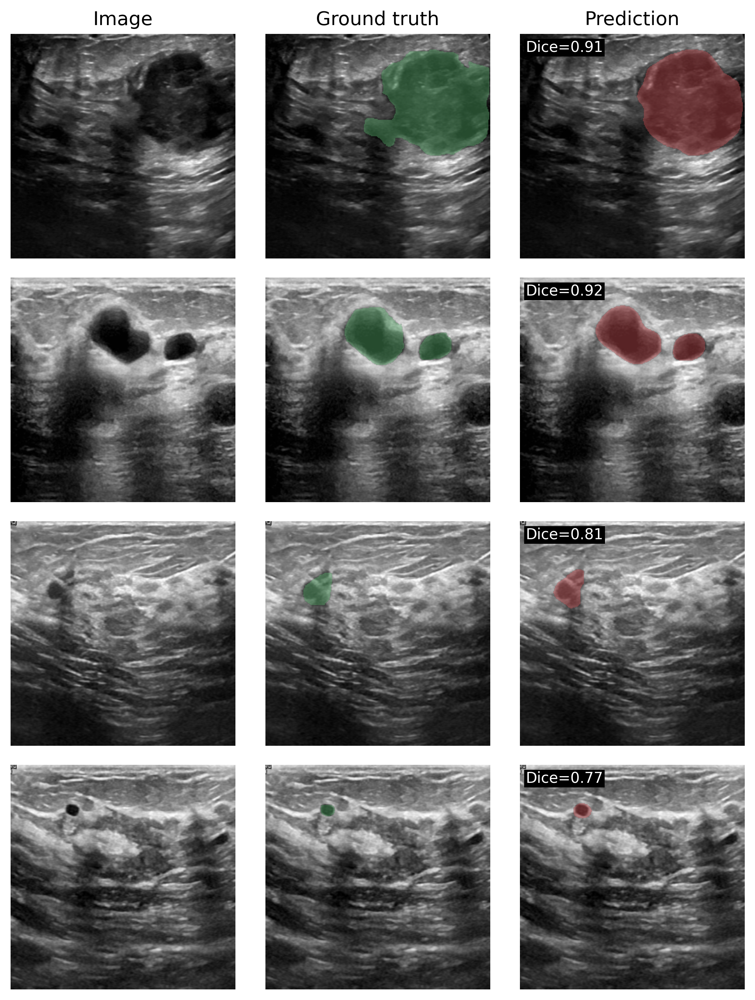
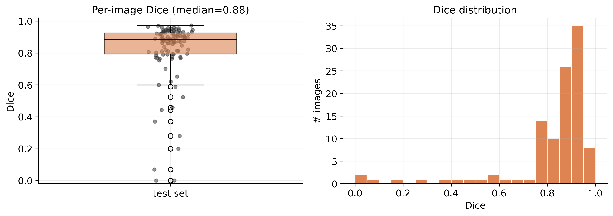

# Breast ultrasound lesion classification with segmentation-guided radiomics/CNN fusion

This repo has the code for a fully automatic benign vs. malignant classifier for breast
ultrasound lesions. A UNet++ segments the lesion. From the predicted ROI we extract 18
handcrafted radiomic features and 2048 deep features from an ImageNet ResNet-50, which is
kept frozen (no fine-tuning). A sparse logistic model combines the two. We train on BUSI
and test on BUS-BRA, which comes from a different institution and different scanners.



## Pipeline

```
BUSI ── pHash dedup ──┬─► UNet++ (EfficientNet-B3) segmentation
                      └─► predicted-mask ROI ─┬─► radiomics (18) ─────────┐
                                              └─► frozen ResNet-50 (2048) ┴─► Scaler → LASSO → LR
BUS-BRA ─────────────────────────────────────────────────────────────────► external test
```

BUSI has many near-duplicate frames, so we remove them with perceptual hashing (Hamming
distance up to 4) before any split. That drops 152 of the 780 images and leaves 340
benign, 193 malignant and 95 normal.

All classification ROIs, internal and external, come from the predicted masks. We never
use the manual masks at inference. A run with the manual masks is kept only as an
ablation.

Scaling, LASSO feature selection (with its own inner CV) and the classifier are all fitted
inside each outer fold. We report stratified 5-fold CV, DeLong tests on the pooled
out-of-fold predictions and bootstrap 95% CIs (1000 resamples). For interpretability we
use exact linear SHAP on the fusion and radiomics-only models, and we describe each
important deep feature by the radiomic features it correlates with most.

## Results

Segmentation: median Dice 0.88 on the BUSI held-out test set (n = 107). On BUS-BRA
(n = 1875), which the segmenter never saw, the median Dice is 0.80, with a mean Dice of
0.74 and a mean IoU of 0.63.

Internal results (BUSI, 533 lesions, 5-fold CV, per-fold mean ± SD):

| Model | AUC | Sensitivity | Specificity | Accuracy |
|---|---|---|---|---|
| Radiomics | 0.889 ± 0.020 | 0.860 ± 0.038 | 0.794 ± 0.045 | 0.818 ± 0.019 |
| Frozen CNN | 0.891 ± 0.018 | 0.761 ± 0.052 | 0.868 ± 0.034 | 0.829 ± 0.016 |
| Fusion | 0.908 ± 0.017 | 0.777 ± 0.047 | 0.879 ± 0.041 | 0.842 ± 0.028 |

The paper reports AUC on the pooled out-of-fold predictions instead: 0.887 for radiomics,
0.892 for the frozen CNN and 0.908 for fusion.

External results (BUS-BRA, 1875 images, 607 malignant):

| Model | AUC (95% CI) | Sensitivity | Specificity | Accuracy |
|---|---|---|---|---|
| Radiomics | 0.692 (0.667-0.715) | 0.435 | 0.789 | 0.674 |
| Frozen CNN | 0.730 (0.705-0.756) | 0.695 | 0.628 | 0.650 |
| Fusion | 0.746 (0.723-0.769) | 0.666 | 0.690 | 0.682 |

On BUS-BRA, fusion is better than radiomics (DeLong p < 0.001) and the frozen CNN
(p = 0.005). Internally, fusion is better than the frozen CNN (p = 0.027) but not
significantly better than radiomics (p = 0.12). All three models lose about 0.16 to 0.20
AUC between BUSI and BUS-BRA.

| | |
|---|---|
|  |  |
|  |  |

The metric tables are in [`results/`](results/).

We also repeated the reference-mask ablation on BUS-BRA
([`results/R2_busbra_ablation.csv`](results/R2_busbra_ablation.csv)). If we keep the
models trained on BUSI predicted masks but take the BUS-BRA ROIs from the manual masks,
external AUC goes from 0.692 to 0.743 for radiomics, 0.730 to 0.796 for the frozen CNN and
0.746 to 0.792 for fusion. So segmentation errors on BUS-BRA account for roughly a quarter
to two-fifths of the drop, and the rest is still there with manual masks.

Removing the five shape features lowers the radiomics AUC from 0.887 to 0.853 internally
and from 0.692 to 0.584 on BUS-BRA. The shape features on their own give 0.845 internally
and 0.770 on BUS-BRA (an exploratory result).

## Setup

```bash
git clone https://github.com/Darshan0109/breast-us-fusion.git
cd breast-us-fusion
pip install -r requirements.txt
```

The paper's results use the scikit-image radiomics backend (18 first-order, GLCM and shape
features). If `pyradiomics` is installed, the notebook switches to the full IBSI feature
set, so leave it out if you want to match the paper.

## Data

We don't redistribute either dataset. Download them into `data/`, or set `DATA_DIR` to
wherever they are:

```
data/
├── Dataset_BUSI_with_GT/{benign,malignant,normal}/*.png
└── BUS_BRA/
    ├── bus_data.csv
    ├── Images/bus_XXXX-{l,r,s}.png
    └── Masks/mask_XXXX-{l,r,s}.png
```

BUSI: Al-Dhabyani et al., Data in Brief, 2020
([Kaggle](https://www.kaggle.com/datasets/aryashah2k/breast-ultrasound-images-dataset)).

BUS-BRA: Gómez-Flores et al., Medical Physics, 2024
([Zenodo](https://zenodo.org/records/8231412)).

## Reproducing the paper's numbers

All the reported results come from one segmentation checkpoint and the features extracted
with it. Both are in `results/`:

- `results/unet_best.pt` (UNet++ with an EfficientNet-B3 encoder)
- `results/features_internal_pred.joblib` and `results/features_external_pred.joblib`
  (predicted-mask features for BUSI and BUS-BRA)

When these files are present, the notebook loads them and skips retraining. If you
retrain the segmenter you will get slightly different masks and numbers, because we did
not enable deterministic cuDNN kernels.

[`notebooks/breast_us_fusion_pipeline_paper_run.ipynb`](notebooks/breast_us_fusion_pipeline_paper_run.ipynb)
is the Colab notebook we used for the paper, saved with its outputs. The last cell has the
analyses we added during revision: BUS-BRA segmentation, the reference-mask ablation on
BUS-BRA and the shape-feature ablation. On Colab it looks for `unet_best.pt` in `/content`
and the two feature files in `/content/results`.

The BUSI de-duplication (152 removed, 628 kept) can be rebuilt with
[`notebooks/busi_deduplication.ipynb`](notebooks/busi_deduplication.ipynb).

## Usage

```bash
DATA_DIR=/path/to/data jupyter lab notebooks/breast_us_fusion_pipeline.ipynb
```

Run all the cells. The settings are in the `CONFIG` dict in the first code cell. The U-Net
checkpoint and the feature tables are cached in `results/`, so a second run skips training
and extraction. Set `force_retrain_seg` or `force_rebuild_features` to `True` if you want
to redo them. A full run (40 epochs plus feature extraction) takes under an hour on one
A100.

## Limitations

BUSI has no patient IDs. De-duplication helps, but the splits are still at the image level.

The segmenter and the internal classifiers use the same BUSI images, so the internal
predicted-mask results may be a little optimistic. BUS-BRA, which the segmenter never saw,
is the better estimate of how the pipeline generalises.

The deep branch is a frozen ImageNet ResNet-50. We did not test a CNN fine-tuned on breast
ultrasound, and it might behave differently across scanners.

## License

The code is MIT licensed. The datasets keep their own licenses.
